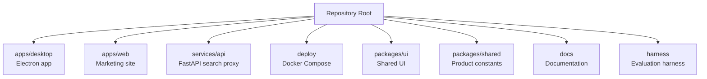
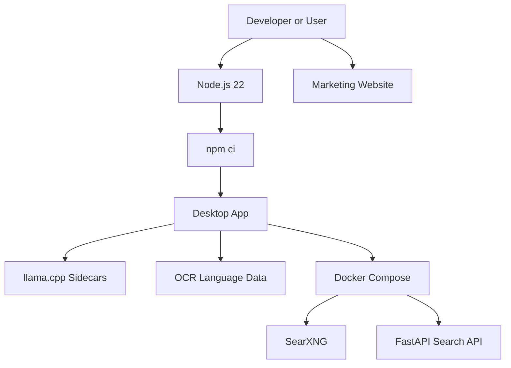
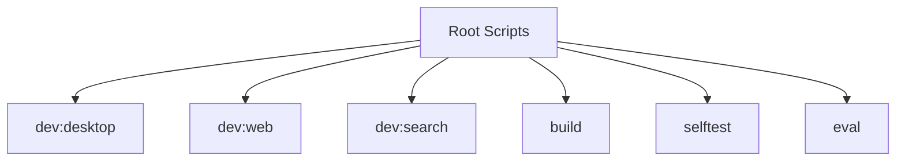

# Getting Started

<cite>
**Referenced Files in This Document**
- [README.md](file://README.md)
- [package.json](file://package.json)
- [apps/desktop/package.json](file://apps/desktop/package.json)
- [apps/desktop/README.md](file://apps/desktop/README.md)
- [deploy/docker-compose.dev.yml](file://deploy/docker-compose.dev.yml)
- [apps/desktop/scripts/fetch-sidecars.mjs](file://apps/desktop/scripts/fetch-sidecars.mjs)
- [apps/desktop/scripts/fetch-tessdata.mjs](file://apps/desktop/scripts/fetch-tessdata.mjs)
- [.github/workflows/ci.yml](file://.github/workflows/ci.yml)
- [apps/web/src/beta-note.tsx](file://apps/web/src/beta-note.tsx)
</cite>

## Table of Contents
1. [Introduction](#introduction)
2. [Project Structure](#project-structure)
3. [Core Components](#core-components)
4. [Architecture Overview](#architecture-overview)
5. [Detailed Component Analysis](#detailed-component-analysis)
6. [Dependency Analysis](#dependency-analysis)
7. [Performance Considerations](#performance-considerations)
8. [Troubleshooting Guide](#troubleshooting-guide)
9. [Conclusion](#conclusion)

## Introduction
Surf.ai is a local-first desktop AI assistant built for privacy and offline use. The application runs on your computer, keeps chats locally, and can run AI models directly on your machine. When you are online, it can update itself or fetch additional resources, but the core experience is designed to work without sending data to external services by default.

This guide helps beginners install Node.js 22, set up dependencies, download required sidecars and OCR models, start the desktop app in development mode, and optionally run the local web search stack with Docker Compose. It also includes platform-specific notes for macOS and Windows, including how to handle unsigned app warnings during the beta.

## Project Structure
The repository is organized as a monorepo:

- `apps/desktop`: Electron-based desktop application.
- `apps/web`: Marketing website.
- `services/api`: FastAPI search proxy and related backend utilities.
- `deploy`: Docker Compose files for development and production.
- `packages/ui` and `packages/shared`: Shared UI and product constants.
- `docs`, `harness`, `scripts`: Documentation, evaluation harness, and utility scripts.



**Diagram sources**
- [README.md:156-169](file://README.md#L156-L169)

**Section sources**
- [README.md:156-169](file://README.md#L156-L169)

## Core Components
Surf.ai consists of several key components that work together during installation and development:

| Component | Purpose | Key Notes |
|---|---|---|
| Desktop App | Local-first AI assistant window | Built with Electron, React, and TypeScript |
| Web Search Stack | Local SearXNG + FastAPI API | Development-only; uses Docker Compose |
| Sidecars | llama.cpp binaries for model execution | Downloaded per platform and architecture |
| OCR Models | Tesseract language data for image text extraction | English and Hindi models bundled |
| Marketing Website | Public-facing site and downloads | Separate dev server from desktop app |

**Section sources**
- [apps/desktop/package.json:1-79](file://apps/desktop/package.json#L1-L79)
- [README.md:156-178](file://README.md#L156-L178)

## Architecture Overview
At a high level, Surf.ai follows this flow:

1. You install Node.js 22 and run dependency setup.
2. The desktop app downloads platform-specific sidecars and OCR models.
3. In development, the app can connect to a local web search stack running via Docker Compose.
4. The marketing website runs separately for documentation and downloads.



**Diagram sources**
- [README.md:7-24](file://README.md#L7-L24)
- [deploy/docker-compose.dev.yml:1-30](file://deploy/docker-compose.dev.yml#L1-L30)

## Detailed Component Analysis

### Installation Prerequisites
Surf.ai requires Node.js version 22 or newer. The root package configuration enforces this engine requirement.

Key steps:
- Install Node.js 22.
- Clone the repository.
- Run `npm ci` at the repository root to install dependencies using the lockfile.

**Section sources**
- [package.json:25-27](file://package.json#L25-L27)
- [README.md:7-18](file://README.md#L7-L18)

### Dependency Setup
Use `npm ci` instead of `npm install` for deterministic installs. The CI workflow retries dependency installation because registry connectivity can be unstable.

Recommended approach:
- From the repository root: `npm ci`
- If native modules fail to build, retry once or twice as shown in CI.

**Section sources**
- [package.json:15-23](file://package.json#L15-L23)
- [.github/workflows/ci.yml:21-35](file://.github/workflows/ci.yml#L21-L35)

### Fetching Sidecars
Sidecars are compiled llama.cpp binaries for your operating system and CPU architecture. They are required for local model execution.

What happens:
- The script detects your platform and architecture.
- It downloads a pinned llama.cpp release asset.
- It extracts the binary into `apps/desktop/resources/bin/<platform>-<arch>/`.
- It writes metadata including tag, asset name, URL, SHA-256, and fetch time.

Command:
```bash
cd apps/desktop
node scripts/fetch-sidecars.mjs
```

Optional GPU flags:
- `--gpu=vulkan` selects Vulkan builds where available.
- On Windows, CUDA builds are available for specific architectures.

**Section sources**
- [apps/desktop/scripts/fetch-sidecars.mjs:1-84](file://apps/desktop/scripts/fetch-sidecars.mjs#L1-L84)
- [.github/workflows/ci.yml:36-44](file://.github/workflows/ci.yml#L36-L44)

### Fetching OCR Models
OCR support uses Tesseract language data. The script bundles English and Hindi trained data so OCR works offline after installation.

What happens:
- Creates `apps/desktop/resources/tessdata`.
- Downloads compressed `.traineddata.gz` files.
- Decompresses them into `.traineddata`.
- Skips existing valid files to avoid unnecessary downloads.

Command:
```bash
cd apps/desktop
node scripts/fetch-tessdata.mjs
```

**Section sources**
- [apps/desktop/scripts/fetch-tessdata.mjs:1-42](file://apps/desktop/scripts/fetch-tessdata.mjs#L1-L42)
- [README.md:14-15](file://README.md#L14-L15)

### Running the Desktop App in Development Mode
After installing dependencies and fetching sidecars and OCR models, start the desktop app.

Quick path:
```bash
npm ci
cd apps/desktop
node scripts/fetch-sidecars.mjs
node scripts/fetch-tessdata.mjs
node node_modules/electron/install.js
npm run dev
```

Alternative root-level command:
```bash
npm run dev:desktop
```

Notes:
- `electron-vite dev` starts the Electron main process and web renderer in development.
- If the Electron binary is missing, run the Electron installer script before starting development.

**Section sources**
- [README.md:7-18](file://README.md#L7-L18)
- [apps/desktop/package.json:9-24](file://apps/desktop/package.json#L9-L24)
- [apps/desktop/README.md:5-17](file://apps/desktop/README.md#L5-L17)

### Setting Up the Web Search Stack with Docker Compose
The local web search stack is development-only. It runs SearXNG with JSON enabled and a FastAPI search API on localhost.

Steps:
1. Install and start Docker Desktop.
2. From the repository root: `npm run dev:search`
3. Wait until the API health endpoint responds.
4. Start the desktop app in another terminal.

Mac example:
```bash
npm ci
npm run dev:search
curl -s http://127.0.0.1:8000/v1/health
npm run dev:desktop
```

Windows PowerShell example:
```powershell
npm ci
npm run dev:search
curl.exe -s http://127.0.0.1:8000/v1/health
npm run dev:desktop
```

Stop the stack:
```bash
docker compose -f deploy/docker-compose.dev.yml down
```

Environment details:
- `SURF_API_LITE=1`: Uses an in-memory quota store without Postgres.
- `SURF_DEV_OPEN=1`: Skips sign-in and daily quota for localhost development.
- `SEARXNG_URL`: Points to the SearXNG container.
- `JWT_SECRET` and `JWT_AUDIENCE`: Required for token handling in development.

**Section sources**
- [README.md:26-76](file://README.md#L26-L76)
- [deploy/docker-compose.dev.yml:1-30](file://deploy/docker-compose.dev.yml#L1-L30)

### Platform-Specific Guidance

#### macOS
- Use Docker Desktop for the local search stack.
- During the beta, the app may not be signed by Apple. macOS may block opening the app.
- To allow the app once:
  1. Open Synap.surf once so macOS blocks it.
  2. Go to System Settings → Privacy & Security.
  3. Scroll to the Security section.
  4. Click Open Anyway next to Synap.surf, then confirm.

File access permissions:
- macOS may restrict access to Desktop, Documents, and Downloads through Files and Folders.
- Some locations may require Full Disk Access under Privacy & Security.

**Section sources**
- [README.md:32-51](file://README.md#L32-L51)
- [README.md:131-140](file://README.md#L131-L140)
- [apps/web/src/beta-note.tsx:1-19](file://apps/web/src/beta-note.tsx#L1-L19)

#### Windows
- Use Docker Desktop and PowerShell or Command Prompt.
- During the beta, Windows may show “Windows protected your PC”.
- To proceed:
  1. Click More info under the warning.
  2. Confirm the Unknown publisher message.
  3. Click Run anyway to install.

**Section sources**
- [README.md:53-76](file://README.md#L53-L76)
- [README.md:131-140](file://README.md#L131-L140)
- [apps/web/src/beta-note.tsx:14-16](file://apps/web/src/beta-note.tsx#L14-L16)

### Quick Start Commands
Desktop application:
```bash
npm ci
cd apps/desktop
node scripts/fetch-sidecars.mjs
node scripts/fetch-tessdata.mjs
npm run dev
```

Marketing website:
```bash
npm run dev:web
```

Local search stack:
```bash
npm run dev:search
```

**Section sources**
- [README.md:7-24](file://README.md#L7-L24)
- [package.json:15-23](file://package.json#L15-L23)

### Initial Model Setup and First Conversation
The desktop app handles model discovery and downloading during onboarding. It reads hardware information, suggests a suitable model from the registry, and downloads it with resume and integrity checks.

Basic usage patterns:
- Create a new chat.
- Type a question or instruction.
- Attach documents such as PDFs, Word files, spreadsheets, slide decks, or images when needed.
- Use the calculator for plain arithmetic and unit conversions.
- Enable or disable Offline only depending on whether you want network features like web search.

For self-testing without full models, you can point the app to a models directory:
```bash
cd apps/desktop
SURF_MODELS_DIR=~/surf-models npm run selftest
```

**Section sources**
- [apps/desktop/README.md:19-40](file://apps/desktop/README.md#L19-L40)
- [README.md:142-147](file://README.md#L142-L147)

## Dependency Analysis
The top-level workspace defines scripts for the desktop app, marketing website, local search stack, type checking, building, self-testing, and evaluation.



**Diagram sources**
- [package.json:15-23](file://package.json#L15-L23)

**Section sources**
- [package.json:1-36](file://package.json#L1-L36)

## Performance Considerations
- Local model execution depends on your CPU, RAM, and optional GPU acceleration through Vulkan or CUDA sidecars.
- Smaller models load faster and use less memory.
- OCR performance improves with pre-bundled language data.
- The local search stack is intended for development; production deployment uses separate infrastructure.

[No sources needed since this section provides general guidance]

## Troubleshooting Guide

### Unsigned App Warnings
During the beta, installers are not signed by Apple or Microsoft.

macOS:
- Allow the app once through System Settings → Privacy & Security → Open Anyway.

Windows:
- Click More info under “Windows protected your PC”, then click Run anyway.

**Section sources**
- [README.md:131-140](file://README.md#L131-L140)
- [apps/web/src/beta-note.tsx:1-19](file://apps/web/src/beta-note.tsx#L1-L19)

### Docker Compose Not Starting
Common causes:
- Docker Desktop is not installed or not running.
- Port 8000 or 8080 is already in use.
- Network restrictions prevent pulling images.

Resolution:
- Start Docker Desktop.
- Run `npm run dev:search`.
- Check the health endpoint: `http://127.0.0.1:8000/v1/health`.
- Stop the stack with `docker compose -f deploy/docker-compose.dev.yml down`.

**Section sources**
- [README.md:26-76](file://README.md#L26-L76)
- [deploy/docker-compose.dev.yml:1-30](file://deploy/docker-compose.dev.yml#L1-L30)

### Missing Electron Binary
If Electron does not download automatically:
```bash
cd apps/desktop
node node_modules/electron/install.js
```

**Section sources**
- [README.md:16](file://README.md#L16)
- [apps/desktop/README.md:14-16](file://apps/desktop/README.md#L14-L16)

### File Access Denied on macOS or Windows
macOS:
- Grant Files and Folders permission for Desktop, Documents, or Downloads.
- For other protected locations, enable Full Disk Access if required.

Windows:
- Check Controlled Folder Access or ACL restrictions.
- Open Windows Security settings if prompted.

**Section sources**
- [apps/desktop/src/main/core/files/os-access.ts:1-73](file://apps/desktop/src/main/core/files/os-access.ts#L1-L73)

### Web Search Returns 403 Without JSON
SearXNG must have JSON enabled. The development compose file sets `search.formats` to include HTML and JSON. If using a public SearXNG instance, ensure JSON is enabled; otherwise, `/search?format=json` returns 403.

**Section sources**
- [README.md:78-115](file://README.md#L78-L115)
- [deploy/docker-compose.dev.yml:24-27](file://deploy/docker-compose.dev.yml#L24-L27)

## Conclusion
You now have the essential steps to install Surf.ai, set up dependencies, fetch sidecars and OCR models, run the desktop app, and optionally start the local web search stack. For most users, the quick start commands are enough to begin chatting locally. Developers can extend the setup by adjusting environment variables, exploring the Docker Compose stack, or contributing to the desktop and web components.

[No sources needed since this section summarizes without analyzing specific files]