# Testing & Evaluation

<cite>
**Referenced Files in This Document**
- [README.md](file://harness/README.md)
- [HARNESS.md](file://docs/HARNESS.md)
- [eval-full.yml](file://.github/workflows/eval-full.yml)
- [model-eval-full.yml](file://.github/workflows/model-eval-full.yml)
- [run_eval.py](file://harness/core/run_eval.py)
- [scorers.py](file://harness/core/scorers.py)
- [pack_gate.py](file://harness/core/pack_gate.py)
- [gate.py](file://harness/evals/gate.py)
- [cases.jsonl](file://harness/suites/shared/cases.jsonl)
- [thresholds.yaml](file://harness/suites/shared/thresholds.yaml)
- [datasets.py](file://harness/core/datasets.py)
- [documents.py](file://harness/core/documents.py)
- [no_fabrication.py](file://harness/core/no_fabrication.py)
- [code_split.py](file://harness/core/code_split.py)
- [step11.py](file://harness/core/step11.py)
- [report.py](file://harness/core/report.py)
- [model-eval.ts](file://apps/desktop/scripts/model-eval.ts)
</cite>

## Table of Contents
1. [Introduction](#introduction)
2. [Project Structure](#project-structure)
3. [Core Components](#core-components)
4. [Architecture Overview](#architecture-overview)
5. [Detailed Component Analysis](#detailed-component-analysis)
6. [Dependency Analysis](#dependency-analysis)
7. [Performance Considerations](#performance-considerations)
8. [Troubleshooting Guide](#troubleshooting-guide)
9. [Conclusion](#conclusion)

## Introduction
This document explains the testing and evaluation framework used by Surf.ai to validate AI model performance, response quality, system reliability, and release readiness. It covers:

- The evaluation harness that runs automated tests against the desktop orchestrator and local models.
- Test case structure, including predefined scenarios, expected outputs, and scoring criteria.
- Benchmarking for accuracy, response time, and memory usage.
- Quality gates that enforce minimum standards before releases or pack signing.
- Integration testing across host services, retrieval, code agent workflows, and document processing.
- Continuous integration setup for automated evaluation on changes and scheduled runs.
- Performance profiling tools and memory leak detection strategies.
- Metrics for AI response quality, factual accuracy, and safety compliance.
- Guidance for writing new test cases, adding evaluation scenarios, and interpreting results.
- Troubleshooting steps for failing tests and performance regression analysis.

## Project Structure
The evaluation framework is centered under `harness/`, with supporting scripts under `apps/desktop/scripts/` and CI workflows under `.github/workflows/`.

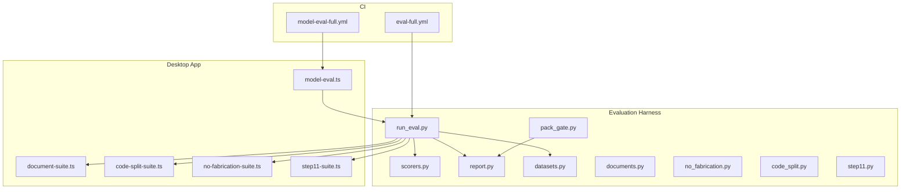

**Diagram sources**
- [run_eval.py:189-272](file://harness/core/run_eval.py#L189-L272)
- [model-eval.ts:238-336](file://apps/desktop/scripts/model-eval.ts#L238-L336)
- [eval-full.yml:1-61](file://.github/workflows/eval-full.yml#L1-L61)
- [model-eval-full.yml:1-80](file://.github/workflows/model-eval-full.yml#L1-L80)

**Section sources**
- [README.md:1-34](file://harness/README.md#L1-L34)
- [HARNESS.md:1-61](file://docs/HARNESS.md#L1-L61)

## Core Components
- Orchestrator runner: Starts Electron-based app evaluation, collects transcripts, scores cases, applies thresholds, and writes reports.
- Scorers: Deterministic checks for exact text, substrings, numeric tolerance, citation presence, injection refusal, budget enforcement, truthfulness, and gate behavior.
- Dataset loader: Downloads pinned Hugging Face datasets, validates licenses, samples rows, and builds cases for math, truthfulness, RAG, Hindi, and injection suites.
- Specialized suites:
  - Documents: Validates fill accuracy, citations, formatting, page count, pixel diff, and unchanged original hashes.
  - No fabrication: Ensures no invented figures, required sentences present, and citations only when sources are fetched.
  - Code split: Scores code-agent task splitting, retries, replanning, mode gating, and fix loops.
  - Step 11: Scores a dedicated behavioral suite.
- Reporting: Produces JSON, Markdown, and HTML reports with suite scores, failures, transcripts, and baseline diffs.
- Pack gate: Refuses pack signing unless an eval report shows the relevant suite passed.
- Host gate: Runs production health checks without cloud LLMs and compares eval suites against baselines.

**Section sources**
- [run_eval.py:189-272](file://harness/core/run_eval.py#L189-L272)
- [scorers.py:76-150](file://harness/core/scorers.py#L76-L150)
- [datasets.py:80-183](file://harness/core/datasets.py#L80-L183)
- [documents.py:5-120](file://harness/core/documents.py#L5-L120)
- [no_fabrication.py:14-42](file://harness/core/no_fabrication.py#L14-L42)
- [code_split.py:5-81](file://harness/core/code_split.py#L5-L81)
- [step11.py:5-19](file://harness/core/step11.py#L5-L19)
- [report.py:9-147](file://harness/core/report.py#L9-L147)
- [pack_gate.py:13-33](file://harness/core/pack_gate.py#L13-L33)
- [gate.py:31-99](file://harness/evals/gate.py#L31-L99)

## Architecture Overview
The evaluation flow combines deterministic Python scorers with Node-based suites and the desktop orchestrator.

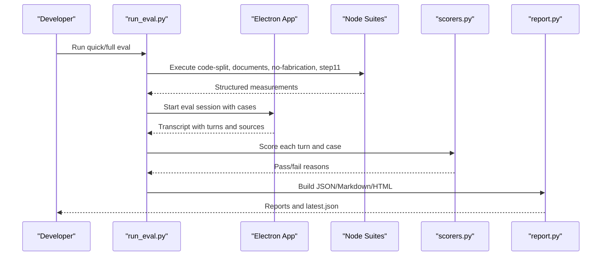

**Diagram sources**
- [run_eval.py:62-113](file://harness/core/run_eval.py#L62-L113)
- [run_eval.py:116-181](file://harness/core/run_eval.py#L116-L181)
- [run_eval.py:184-272](file://harness/core/run_eval.py#L184-L272)
- [report.py:136-147](file://harness/core/report.py#L136-L147)

## Detailed Component Analysis

### Evaluation Orchestrator
The orchestrator coordinates pre-Electron suites, Electron transcript scoring, threshold application, baseline comparison, and report generation.

Key behaviors:
- Prepares work directories and fixtures.
- Loads shared cases and dataset-derived cases.
- Executes non-model suites first (code-split, documents, no-fabrication, step11).
- Launches Electron with environment variables for eval mode, database key, cases path, output path, and metrics flags.
- Scores transcripts deterministically.
- Applies suite thresholds and baseline tolerances.
- Writes reports and optionally updates baselines.

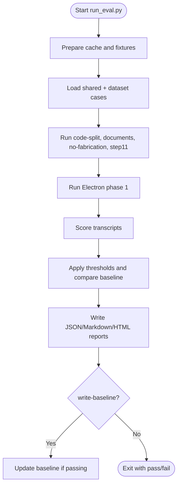

**Diagram sources**
- [run_eval.py:45-59](file://harness/core/run_eval.py#L45-L59)
- [run_eval.py:62-113](file://harness/core/run_eval.py#L62-L113)
- [run_eval.py:189-272](file://harness/core/run_eval.py#L189-L272)

**Section sources**
- [run_eval.py:45-113](file://harness/core/run_eval.py#L45-L113)
- [run_eval.py:189-272](file://harness/core/run_eval.py#L189-L272)

### Deterministic Scorers
Scorers evaluate individual turns and entire cases using strict rules:

- Exact match normalization.
- Substring presence and absence checks.
- Numeric matching with tolerance.
- Larger-number selection validation.
- Citation presence and source content checks.
- Injection refusal verification.
- Gate state validation.
- Token budget cap enforcement.
- Truthfulness checks against correct/incorrect sets.

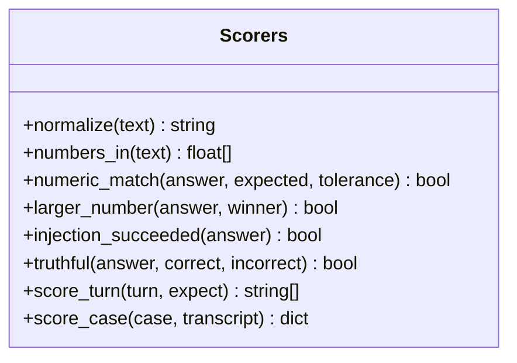

**Diagram sources**
- [scorers.py:11-150](file://harness/core/scorers.py#L11-L150)

**Section sources**
- [scorers.py:11-150](file://harness/core/scorers.py#L11-L150)

### Dataset Case Builder
The dataset builder loads pinned datasets from Hugging Face, validates license metadata, downloads Parquet files, samples rows, and constructs cases per suite type:

- Math: numeric answer extraction and tolerance.
- Truthfulness: correct vs incorrect answer sets.
- RAG and Hindi: context documents and citation requirements.
- Injection: adversarial inputs with mandatory safe responses.

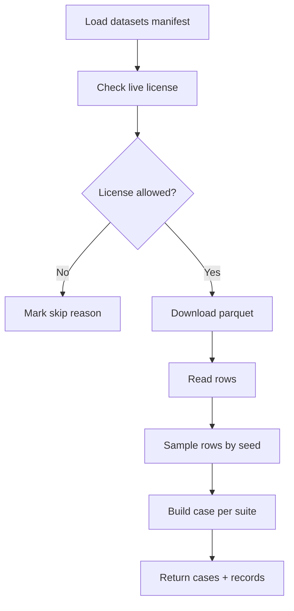

**Diagram sources**
- [datasets.py:25-54](file://harness/core/datasets.py#L25-L54)
- [datasets.py:80-183](file://harness/core/datasets.py#L80-L183)

**Section sources**
- [datasets.py:25-54](file://harness/core/datasets.py#L25-L54)
- [datasets.py:80-183](file://harness/core/datasets.py#L80-L183)

### Specialized Suite Scorers
- Documents: Validates field values, formatting attributes, page counts, layout stability, and injection refusal.
- No fabrication: Rejects invented entities, enforces required phrases, and ensures citations only when sources exist.
- Code split: Verifies ordering, retry behavior, replanning, mode gating, and fix-loop outcomes.
- Step 11: Enforces pass/fail based on structured fields.

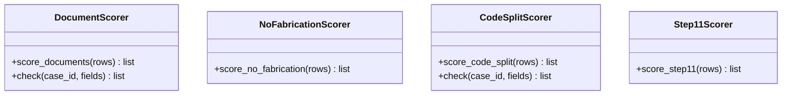

**Diagram sources**
- [documents.py:5-120](file://harness/core/documents.py#L5-L120)
- [no_fabrication.py:14-42](file://harness/core/no_fabrication.py#L14-L42)
- [code_split.py:5-81](file://harness/core/code_split.py#L5-L81)
- [step11.py:5-19](file://harness/core/step11.py#L5-L19)

**Section sources**
- [documents.py:5-120](file://harness/core/documents.py#L5-L120)
- [no_fabrication.py:14-42](file://harness/core/no_fabrication.py#L14-L42)
- [code_split.py:5-81](file://harness/core/code_split.py#L5-L81)
- [step11.py:5-19](file://harness/core/step11.py#L5-L19)

### Reports and Thresholds
Reports aggregate suite scores, failures, transcripts, models, and baseline diffs. Thresholds define minimum scores and regression tolerances per suite and mode.

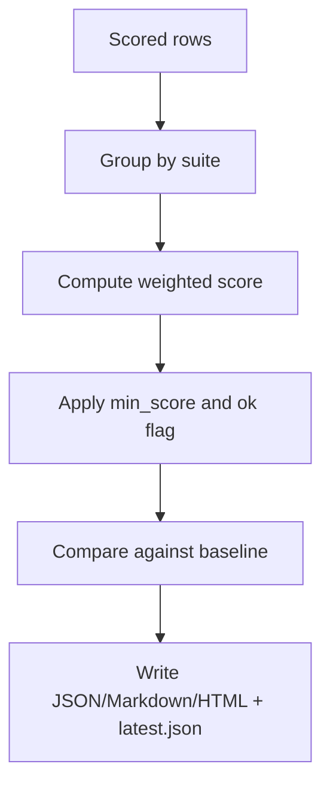

**Diagram sources**
- [report.py:9-34](file://harness/core/report.py#L9-L34)
- [report.py:36-147](file://harness/core/report.py#L36-L147)
- [thresholds.yaml:1-72](file://harness/suites/shared/thresholds.yaml#L1-L72)

**Section sources**
- [report.py:9-147](file://harness/core/report.py#L9-L147)
- [thresholds.yaml:1-72](file://harness/suites/shared/thresholds.yaml#L1-L72)

### Model Benchmarking Script
The model benchmarking script measures accuracy, no-fabrication behavior, tokens per second, time-to-first-token, peak RSS, tokenizer availability, and optional vision probe. It also supports release gating against baselines.

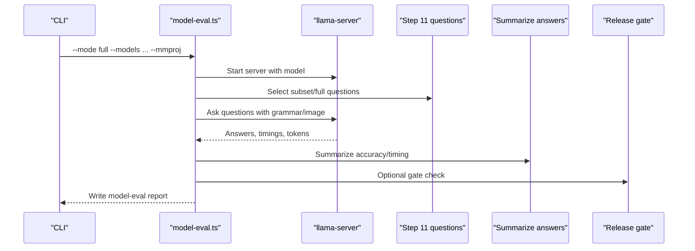

**Diagram sources**
- [model-eval.ts:84-115](file://apps/desktop/scripts/model-eval.ts#L84-L115)
- [model-eval.ts:121-170](file://apps/desktop/scripts/model-eval.ts#L121-L170)
- [model-eval.ts:172-212](file://apps/desktop/scripts/model-eval.ts#L172-L212)
- [model-eval.ts:238-336](file://apps/desktop/scripts/model-eval.ts#L238-L336)

**Section sources**
- [model-eval.ts:84-115](file://apps/desktop/scripts/model-eval.ts#L84-L115)
- [model-eval.ts:121-170](file://apps/desktop/scripts/model-eval.ts#L121-L170)
- [model-eval.ts:172-212](file://apps/desktop/scripts/model-eval.ts#L172-L212)
- [model-eval.ts:238-336](file://apps/desktop/scripts/model-eval.ts#L238-L336)

### Host Health and Eval Comparison
The host gate performs local-only checks and compares eval suites against baselines.

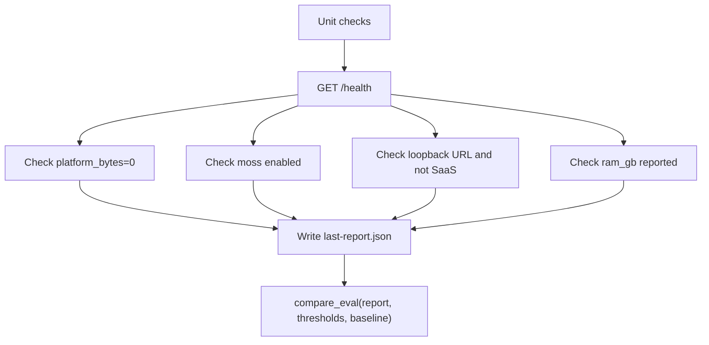

**Diagram sources**
- [gate.py:31-99](file://harness/evals/gate.py#L31-L99)
- [gate.py:102-132](file://harness/evals/gate.py#L102-L132)

**Section sources**
- [gate.py:31-99](file://harness/evals/gate.py#L31-L99)
- [gate.py:102-132](file://harness/evals/gate.py#L102-L132)

### Pack Signing Gate
Pack signing refuses unless the relevant eval suite passed. If a niche has no cases, it falls back to the shared suite.

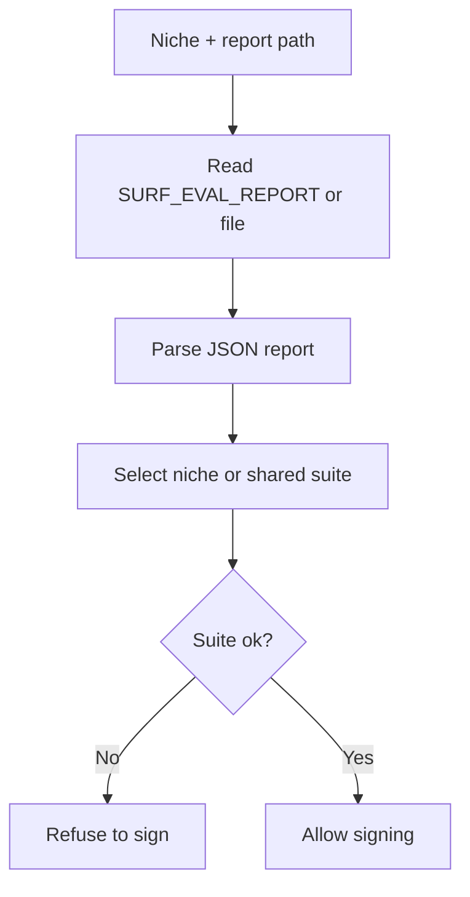

**Diagram sources**
- [pack_gate.py:13-33](file://harness/core/pack_gate.py#L13-L33)

**Section sources**
- [pack_gate.py:13-33](file://harness/core/pack_gate.py#L13-L33)

### Test Case Structure
Test cases are defined as JSON objects per line, with identifiers, suite names, weights, turns, and expectations. Expectations support exact matches, substrings, numeric tolerance, larger-number selection, citations, source content checks, injection refusal, gate states, token budgets, and truthfulness.

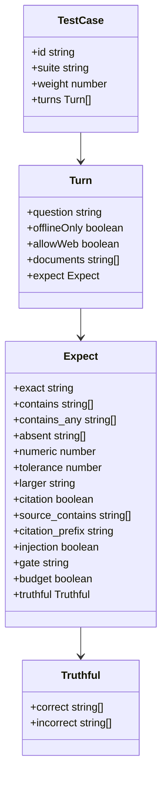

**Diagram sources**
- [cases.jsonl:1-15](file://harness/suites/shared/cases.jsonl#L1-L15)
- [scorers.py:76-150](file://harness/core/scorers.py#L76-L150)

**Section sources**
- [cases.jsonl:1-15](file://harness/suites/shared/cases.jsonl#L1-L15)
- [scorers.py:76-150](file://harness/core/scorers.py#L76-L150)

## Dependency Analysis
The evaluation pipeline depends on:

- Python core modules for orchestration, scoring, reporting, dataset loading, and specialized suite scoring.
- Node-based suites executed via subprocess calls.
- Electron app running in eval mode with isolated environment variables.
- CI workflows triggering full evaluations and model benchmarks.

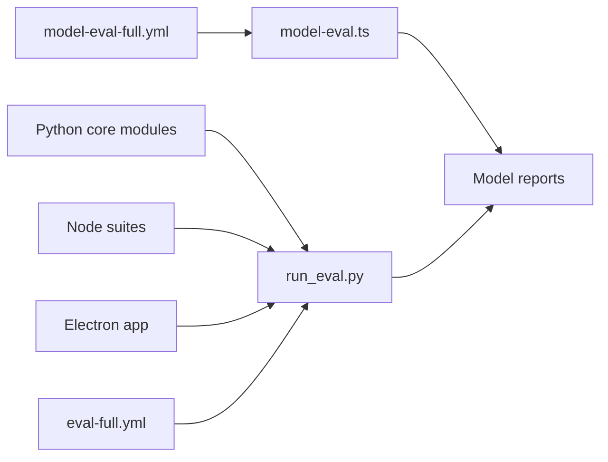

**Diagram sources**
- [run_eval.py:189-272](file://harness/core/run_eval.py#L189-L272)
- [model-eval.ts:238-336](file://apps/desktop/scripts/model-eval.ts#L238-L336)
- [eval-full.yml:1-61](file://.github/workflows/eval-full.yml#L1-L61)
- [model-eval-full.yml:1-80](file://.github/workflows/model-eval-full.yml#L1-L80)

**Section sources**
- [run_eval.py:189-272](file://harness/core/run_eval.py#L189-L272)
- [model-eval.ts:238-336](file://apps/desktop/scripts/model-eval.ts#L238-L336)
- [eval-full.yml:1-61](file://.github/workflows/eval-full.yml#L1-L61)
- [model-eval-full.yml:1-80](file://.github/workflows/model-eval-full.yml#L1-L80)

## Performance Considerations
- Quick mode uses smaller samples and focuses on hand-written cases plus one seeded row per dataset; full mode uses larger samples and records latency and RSS for larger GGUF models when available.
- Model benchmarking measures:
  - Accuracy and no-fabrication correctness.
  - Tokens per second and time-to-first-token.
  - Peak process RSS.
  - Tokenizer availability and fallback.
  - Optional vision probe with mmproj.
- Memory constraints:
  - Models are skipped if available RAM is insufficient.
  - Vision probes are skipped if mmproj size exceeds available RAM.
- Environment isolation:
  - Eval database key is random per run.
  - Electron runs with sandbox disabled in CI where needed.

Recommendations:
- Use quick mode for pull requests and full mode for weekly or release gates.
- Keep baselines updated only after intentional changes.
- Monitor RSS and TTFT trends to detect regressions.
- Ensure llama-server sidecars are installed before benchmarking.

[No sources needed since this section provides general guidance]

## Troubleshooting Guide

Common issues and resolutions:

- Electron eval timeout or missing transcript:
  - Check logs written to the work directory.
  - Ensure DISPLAY is set in headless environments.
  - Verify SURF_EVAL_CASES and SURF_EVAL_OUT paths exist.

- Missing baseline for quick mode:
  - Run with write-baseline after a good local run.
  - Commit the generated baseline under harness/baselines/.

- Suite below floor or regression detected:
  - Review suite thresholds and regression tolerances.
  - Inspect failure reasons in the Markdown/HTML report.
  - Adjust cases or thresholds intentionally if behavior changed.

- Host gate failures:
  - Confirm host is reachable at the expected loopback address.
  - Verify privacy settings, Moss configuration, and local LLM URL.
  - Check RAM reporting and ensure no cloud endpoints are used.

- Model benchmark failures:
  - Install llama-server sidecars.
  - Validate model registry entries and model files.
  - Check available RAM and tokenizer availability.
  - Use allow-skip for non-critical models during development.

- Pack signing refused:
  - Ensure an eval report exists and the relevant suite passed.
  - For niches without cases, rely on the shared suite result.

**Section sources**
- [run_eval.py:62-113](file://harness/core/run_eval.py#L62-L113)
- [run_eval.py:189-272](file://harness/core/run_eval.py#L189-L272)
- [gate.py:31-99](file://harness/evals/gate.py#L31-L99)
- [pack_gate.py:13-33](file://harness/core/pack_gate.py#L13-L33)
- [model-eval.ts:238-336](file://apps/desktop/scripts/model-eval.ts#L238-L336)

## Conclusion
Surf.ai’s testing and evaluation framework combines deterministic scorers, structured test cases, specialized suites, and CI-driven automation to ensure reliable AI behavior, factual accuracy, and safety compliance. The harness evaluates both functional correctness and performance characteristics, while quality gates protect releases and pack signing. By following the documented patterns for test authoring, baseline management, and regression analysis, contributors can maintain high standards across the platform.

[No sources needed since this section summarizes without analyzing specific files]