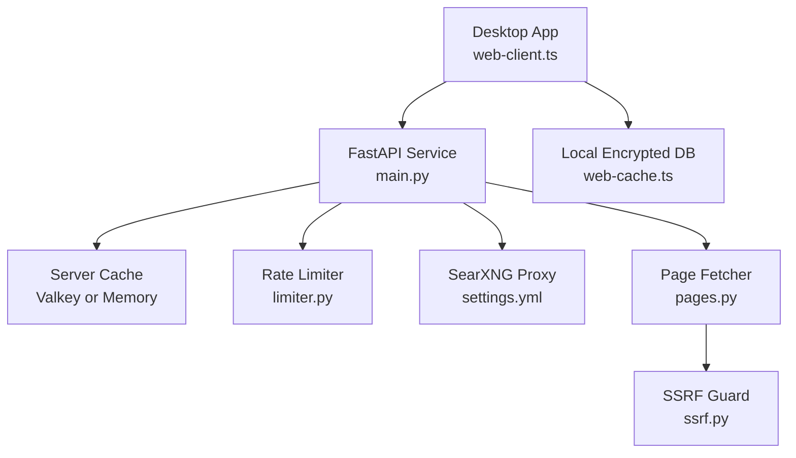
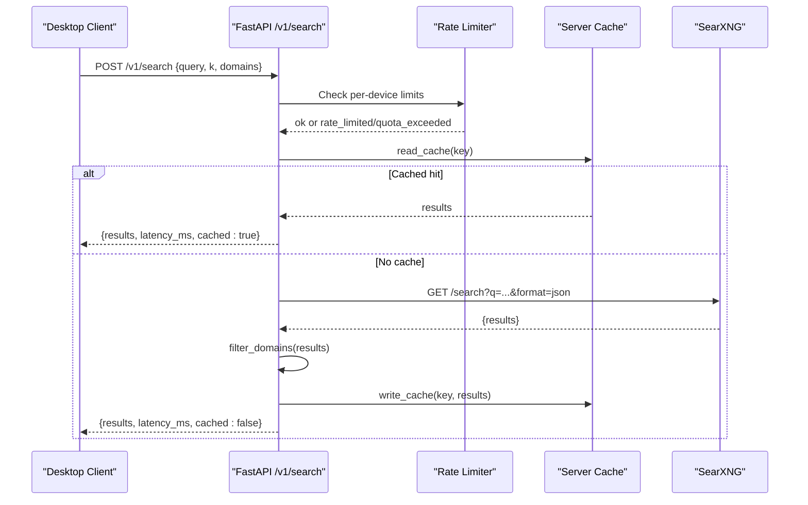
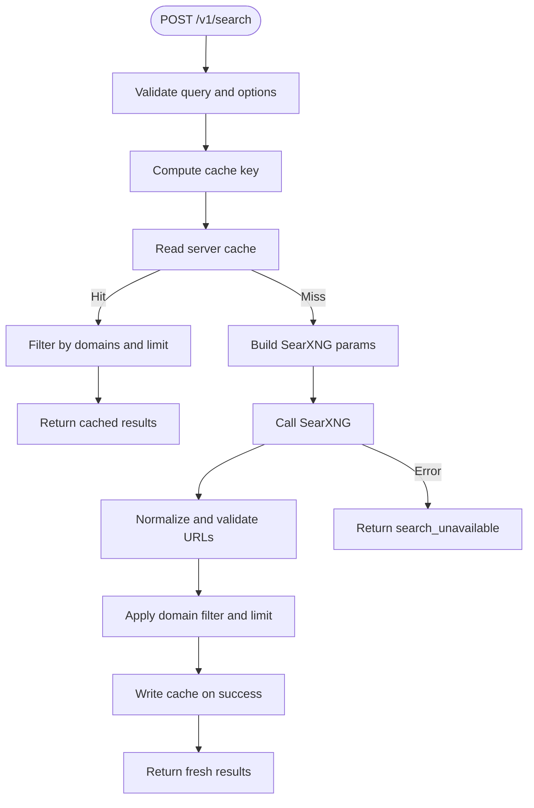
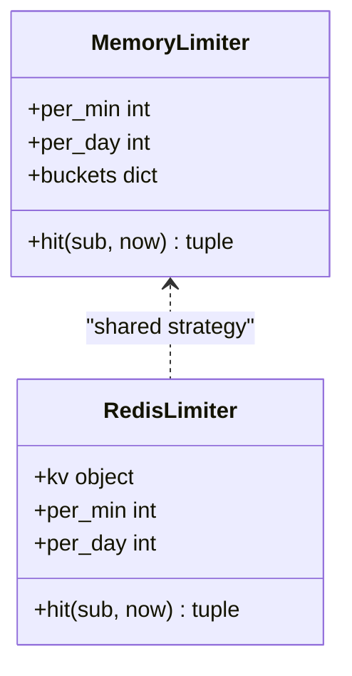
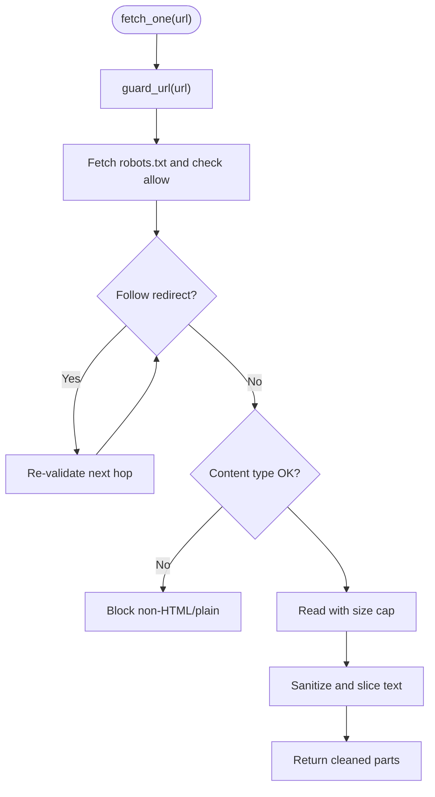
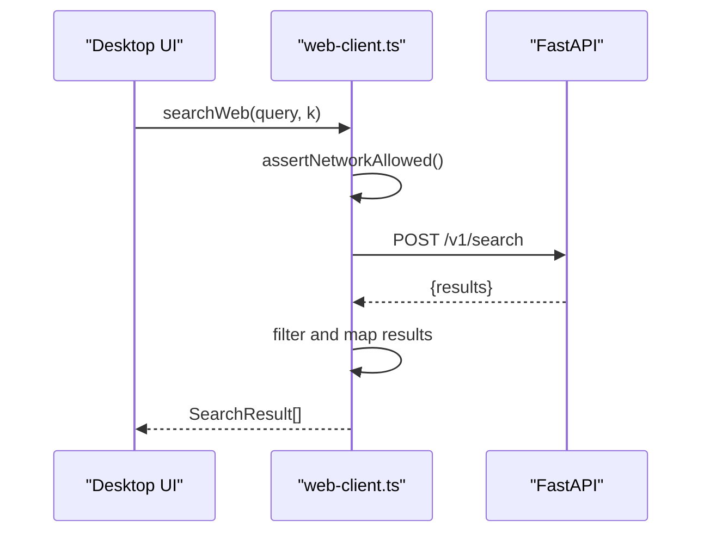
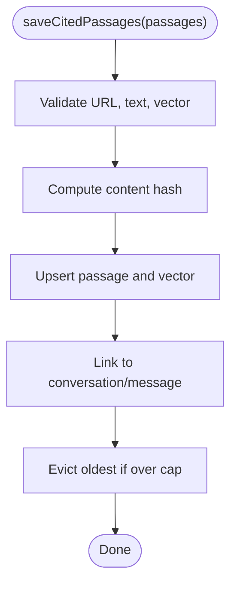
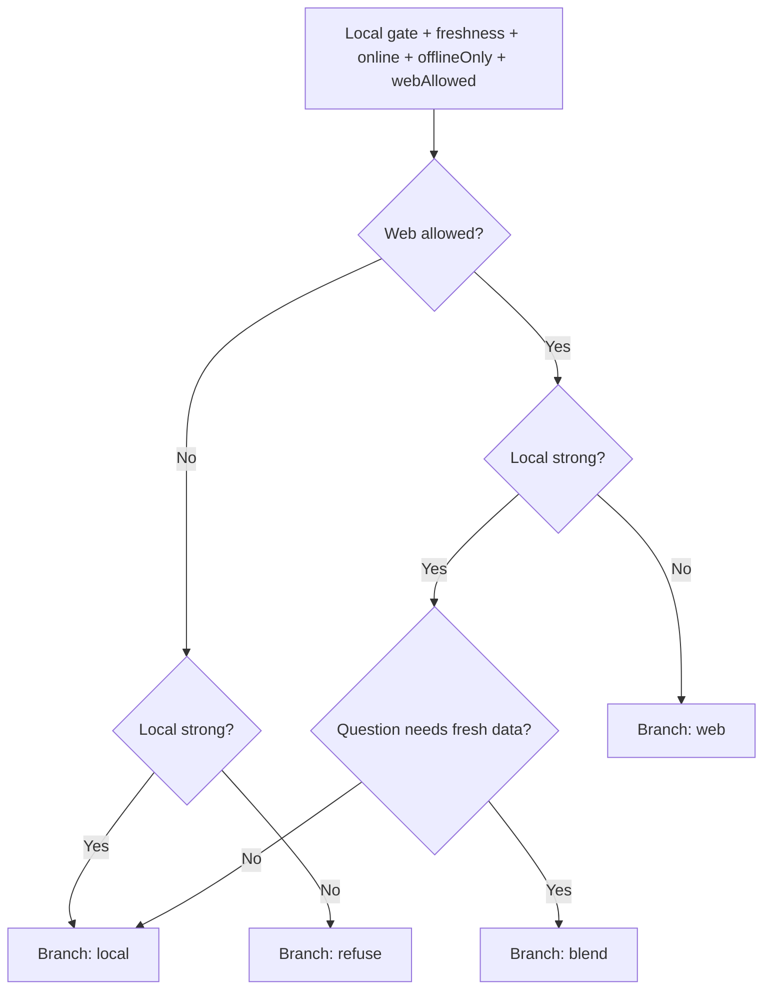
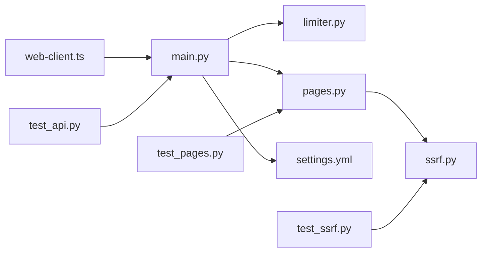

# Web Search Integration

<cite>
**Referenced Files in This Document**
- [main.py](file://services/api/app/main.py)
- [limiter.py](file://services/api/app/limiter.py)
- [ssrf.py](file://services/api/app/ssrf.py)
- [pages.py](file://services/api/app/pages.py)
- [settings.yml](file://deploy/searxng/settings.yml)
- [web-client.ts](file://apps/desktop/src/main/core/web-client.ts)
- [web-cache.ts](file://apps/desktop/src/main/core/web-cache.ts)
- [web-decision.ts](file://apps/desktop/src/main/core/web-decision.ts)
- [test_api.py](file://services/api/tests/test_api.py)
- [test_pages.py](file://services/api/tests/test_pages.py)
- [test_ssrf.py](file://services/api/tests/test_ssrf.py)
</cite>

## Table of Contents
1. [Introduction](#introduction)
2. [Project Structure](#project-structure)
3. [Core Components](#core-components)
4. [Architecture Overview](#architecture-overview)
5. [Detailed Component Analysis](#detailed-component-analysis)
6. [Dependency Analysis](#dependency-analysis)
7. [Performance Considerations](#performance-considerations)
8. [Troubleshooting Guide](#troubleshooting-guide)
9. [Conclusion](#conclusion)

## Introduction
This document explains the privacy-focused web search integration used by Surf.ai. The desktop app does not query public search engines directly. Instead, it calls a local or hosted FastAPI service that proxies queries to SearXNG. The API enforces authentication, rate limits, result caching, and domain filtering. It also provides a safe page fetcher with SSRF protection and content sanitization. On the desktop side, the client manages network policy, request shaping, and response validation. Saved search passages are stored locally in an encrypted database to support offline retrieval and reduce redundant network traffic.

## Project Structure
The web search feature spans two main areas:

- Backend FastAPI service:
  - Search proxy to SearXNG
  - Authentication and device-scoped rate limiting
  - Short-lived server-side cache
  - Safe HTML fetching with SSRF guards and robots.txt respect
  - Domain filtering for trusted sources

- Desktop web client:
  - Network policy enforcement before any outbound call
  - Query rewriting and body construction
  - Response normalization and URL validation
  - Local passage storage, vector indexing, and hybrid search over saved results

**Diagram sources**
- [main.py:380-420](file://services/api/app/main.py#L380-L420)
- [limiter.py:15-46](file://services/api/app/limiter.py#L15-L46)
- [pages.py:46-93](file://services/api/app/pages.py#L46-L93)
- [ssrf.py:61-89](file://services/api/app/ssrf.py#L61-L89)
- [settings.yml:1-11](file://deploy/searxng/settings.yml#L1-L11)
- [web-client.ts:56-85](file://apps/desktop/src/main/core/web-client.ts#L56-L85)
- [web-cache.ts:133-177](file://apps/desktop/src/main/core/web-cache.ts#L133-L177)

**Section sources**
- [main.py:1-84](file://services/api/app/main.py#L1-L84)
- [web-client.ts:1-123](file://apps/desktop/src/main/core/web-client.ts#L1-L123)
- [web-cache.ts:1-59](file://apps/desktop/src/main/core/web-cache.ts#L1-L59)
- [settings.yml:1-11](file://deploy/searxng/settings.yml#L1-L11)

## Core Components
- Privacy-first search proxy:
  - Accepts short, sanitized queries from the desktop.
  - Proxies JSON requests to SearXNG.
  - Normalizes results and applies domain filters.
  - Caches successful responses using a hash key that excludes raw query text.

- Authentication and rate limiting:
  - Requires a valid bearer token with device identity.
  - Supports development bypass only in local lite mode.
  - Enforces per-device minute and day limits using memory or Redis-backed counters.

- Safe page fetching:
  - Validates scheme, host, port, and resolved IP addresses.
  - Honors robots.txt and rejects unsafe redirects.
  - Limits content size and accepts only HTML or plain text.
  - Sanitizes content and returns small text slices.

- Desktop client:
  - Enforces offline-only policy before making network calls.
  - Builds minimal search payloads and validates returned URLs.
  - Stores cited passages locally with vectors for hybrid search.

**Section sources**
- [main.py:350-451](file://services/api/app/main.py#L350-L451)
- [limiter.py:1-46](file://services/api/app/limiter.py#L1-L46)
- [pages.py:1-99](file://services/api/app/pages.py#L1-L99)
- [ssrf.py:1-102](file://services/api/app/ssrf.py#L1-L102)
- [web-client.ts:56-123](file://apps/desktop/src/main/core/web-client.ts#L56-L123)
- [web-cache.ts:133-264](file://apps/desktop/src/main/core/web-cache.ts#L133-L264)

## Architecture Overview
The end-to-end flow starts in the desktop app, which decides whether to use local documents, web search, or both. When web search is allowed, the client sends a short query to the FastAPI service. The service authenticates the request, checks rate limits, looks up cached results, and if needed, forwards the query to SearXNG. Results are filtered by domain and optionally cached. For page reading, the service performs strict SSRF checks, respects robots.txt, sanitizes content, and returns small text chunks.

**Diagram sources**
- [main.py:380-420](file://services/api/app/main.py#L380-L420)
- [limiter.py:15-46](file://services/api/app/limiter.py#L15-L46)

## Detailed Component Analysis

### FastAPI Search Endpoint
The search endpoint validates input, computes a stable cache key, reads the cache, constructs SearXNG parameters, normalizes results, applies domain filtering, writes the cache on success, and records privacy-preserving metrics without storing query text.

Key behaviors:
- Input validation enforces maximum length and optional niche/time-range fields.
- Cache key includes normalized query, result count, sorted domains, language, time range, and niche.
- Upstream errors return a structured error with retry guidance.
- Audit records set query_text to null to preserve privacy.

**Diagram sources**
- [main.py:350-420](file://services/api/app/main.py#L350-L420)

**Section sources**
- [main.py:350-420](file://services/api/app/main.py#L350-L420)

### Server-Side Rate Limiting
Rate limiting uses per-device buckets for one-minute and one-day windows. In production, Redis stores counters; in lite mode, an in-memory map is used. The limiter returns either ok or a specific error code with a suggested retry delay.

Important details:
- Minute bucket resets every 60 seconds.
- Day bucket resets every 86400 seconds.
- Excessive per-minute usage yields rate_limited.
- Daily quota exceeded yields quota_exceeded.

**Diagram sources**
- [limiter.py:15-46](file://services/api/app/limiter.py#L15-L46)

**Section sources**
- [limiter.py:1-46](file://services/api/app/limiter.py#L1-L46)
- [main.py:109-116](file://services/api/app/main.py#L109-L116)

### SSRF Protection and Page Fetching
The page fetcher protects against server-side request forgery by validating schemes, hosts, ports, and resolved IPs. It honors robots.txt, follows a limited number of redirects while re-checking each hop, caps content size, and accepts only HTML or plain text. Content is sanitized and sliced into small chunks.

Security properties:
- Only http and https are allowed.
- Userinfo in URLs is rejected.
- Loopback, link-local, private, reserved, multicast, and unspecified addresses are blocked.
- Non-standard ports are blocked unless explicitly allowed.
- DNS resolution is checked; all resolved addresses must be public.
- robots.txt disallow blocks the target URL.

**Diagram sources**
- [pages.py:46-93](file://services/api/app/pages.py#L46-L93)
- [ssrf.py:61-89](file://services/api/app/ssrf.py#L61-L89)

**Section sources**
- [pages.py:1-99](file://services/api/app/pages.py#L1-L99)
- [ssrf.py:1-102](file://services/api/app/ssrf.py#L1-L102)
- [test_pages.py:42-73](file://services/api/tests/test_pages.py#L42-L73)
- [test_ssrf.py:4-58](file://services/api/tests/test_ssrf.py#L4-L58)

### Desktop Web Client
The desktop client enforces offline-only policy, attaches authorization headers, and calls the API endpoints. It normalizes search results and ensures URLs are well-formed HTTP links. It also supports fetching pages through the service and probing health.

Responsibilities:
- Assert network policy before any request.
- Build minimal search bodies with query and result count.
- Filter and map API responses into typed results.
- Provide a health probe for service availability.

**Diagram sources**
- [web-client.ts:56-85](file://apps/desktop/src/main/core/web-client.ts#L56-L85)

**Section sources**
- [web-client.ts:1-123](file://apps/desktop/src/main/core/web-client.ts#L1-L123)

### Local Passage Cache and Offline Retrieval
Saved web passages are stored in the user’s encrypted database. Each passage includes its URL, content hash, title, domain, text, byte size, timestamps, published date, and a 256-dimensional embedding vector. A full-text index and a vector index enable hybrid search. Citations link passages to conversations and messages.

Features:
- Deduplication by URL and content hash.
- Automatic vector insertion and last-used updates.
- Eviction based on total bytes and least recently used.
- Hybrid ranking combining BM25 and cosine similarity.
- Staleness notes for older passages when freshness matters.

**Diagram sources**
- [web-cache.ts:133-177](file://apps/desktop/src/main/core/web-cache.ts#L133-L177)

**Section sources**
- [web-cache.ts:1-59](file://apps/desktop/src/main/core/web-cache.ts#L1-L59)
- [web-cache.ts:133-264](file://apps/desktop/src/main/core/web-cache.ts#L133-L264)

### Query Decision Logic
The desktop decides whether to rely on local documents, add web search, blend both, or refuse due to insufficient information. Freshness keywords can trigger web usage even when local hits are strong. The client builds a minimal search body containing only the rewritten query and desired result count.

Key behaviors:
- Strong local hits stay local unless freshness is requested.
- Weak hits require web access or produce a refusal message.
- Queries are trimmed and limited before leaving the device.

**Diagram sources**
- [web-decision.ts:44-57](file://apps/desktop/src/main/core/web-decision.ts#L44-L57)

**Section sources**
- [web-decision.ts:1-154](file://apps/desktop/src/main/core/web-decision.ts#L1-L154)

## Dependency Analysis
The backend depends on SearXNG for search results, a key-value store for caching, and optionally Postgres for persistence. The desktop depends on the FastAPI endpoints and local SQLite-based storage for saved passages. Tests verify caching behavior, SSRF blocking, and fetch safety.

**Diagram sources**
- [web-client.ts:56-85](file://apps/desktop/src/main/core/web-client.ts#L56-L85)
- [main.py:380-420](file://services/api/app/main.py#L380-L420)
- [limiter.py:15-46](file://services/api/app/limiter.py#L15-L46)
- [pages.py:46-93](file://services/api/app/pages.py#L46-L93)
- [ssrf.py:61-89](file://services/api/app/ssrf.py#L61-L89)
- [settings.yml:1-11](file://deploy/searxng/settings.yml#L1-L11)
- [test_api.py:64-77](file://services/api/tests/test_api.py#L64-L77)
- [test_pages.py:42-73](file://services/api/tests/test_pages.py#L42-L73)
- [test_ssrf.py:4-58](file://services/api/tests/test_ssrf.py#L4-L58)

**Section sources**
- [test_api.py:64-77](file://services/api/tests/test_api.py#L64-L77)
- [test_pages.py:42-73](file://services/api/tests/test_pages.py#L42-L73)
- [test_ssrf.py:4-58](file://services/api/tests/test_ssrf.py#L4-L58)

## Performance Considerations
- Server-side cache reduces repeated upstream calls. Cache TTL is configurable via environment variables.
- Domain filtering reduces payload size and focuses results on trusted sources.
- Result normalization truncates snippets to a fixed length.
- Local passage storage avoids redundant downloads for cited content and enables fast offline retrieval.
- Hybrid search combines lexical and vector matching for better relevance with fewer network calls.

[No sources needed since this section provides general guidance]

## Troubleshooting Guide
Common issues and resolutions:

- Search unavailable:
  - Cause: SearXNG upstream failure.
  - Symptom: Error code indicates search_unavailable with a retry suggestion.
  - Action: Verify SearXNG health and connectivity.

- Rate limited or quota exceeded:
  - Cause: Too many searches per minute or daily quota reached.
  - Symptom: 429 status with rate_limited or quota_exceeded.
  - Action: Wait for the suggested retry window or adjust quotas.

- SSRF blocked during page fetch:
  - Cause: Target URL resolves to private, loopback, metadata, or disallowed address/port.
  - Symptom: Errors include address, host, port, scheme, userinfo, dns, redirect, html, or robots reasons.
  - Action: Use public URLs and ensure robots.txt allows access.

- Cache not returning expected results:
  - Cause: Cache key differences due to domain sorting, language, time range, or niche.
  - Action: Ensure consistent search options across requests.

- Offline-only mode prevents web search:
  - Cause: Network policy blocks outbound requests.
  - Action: Enable web search when online and allowed.

**Section sources**
- [main.py:380-420](file://services/api/app/main.py#L380-L420)
- [limiter.py:15-46](file://services/api/app/limiter.py#L15-L46)
- [pages.py:46-93](file://services/api/app/pages.py#L46-L93)
- [ssrf.py:61-89](file://services/api/app/ssrf.py#L61-L89)
- [test_api.py:64-77](file://services/api/tests/test_api.py#L64-L77)
- [test_pages.py:42-73](file://services/api/tests/test_pages.py#L42-L73)
- [test_ssrf.py:4-58](file://services/api/tests/test_ssrf.py#L4-L58)

## Conclusion
Surf.ai’s web search integration prioritizes privacy and safety. The desktop app never contacts search engines directly; it delegates to a FastAPI service that proxies SearXNG, enforces authentication and rate limits, caches results, and filters domains. The page fetcher adds robust SSRF protection, robots.txt compliance, content sanitization, and size limits. Locally, cited passages are stored with embeddings to support offline access and efficient hybrid search. Together, these components provide reliable, secure, and privacy-preserving web search capabilities.

[No sources needed since this section summarizes without analyzing specific files]